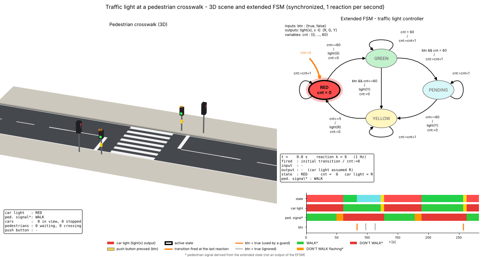

# Finite State Machines

### Usage
```
    python traffic_light_efsm.py                       # 3D crosswalk (left) + FSM (right)
    python traffic_light_efsm.py --fsm-only            # 2D FSM animation only
    python traffic_light_efsm.py --check               # reachable states + reaction trace
    python traffic_light_efsm.py --fps 8 --substeps 2  # playback speed
    python traffic_light_efsm.py --t-green 20 --t-yellow 3 --t-end 120   # short demo
    python traffic_light_efsm.py --save crosswalk.gif  # or .mp4 (ffmpeg)
```
## Traffic-light crosswalk


