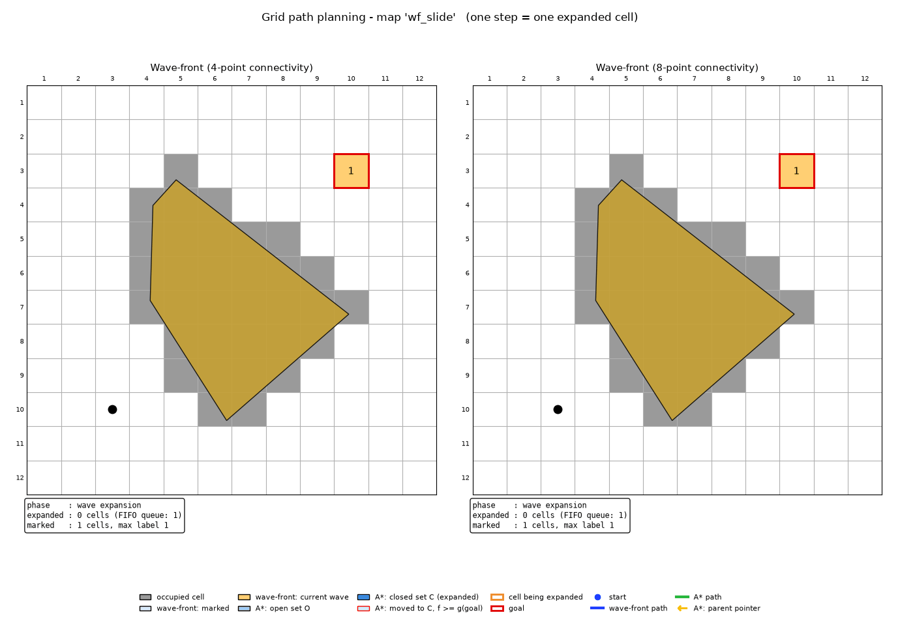
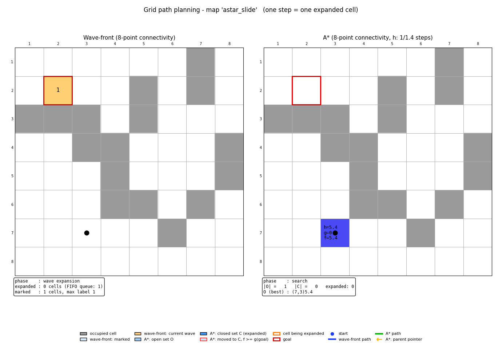
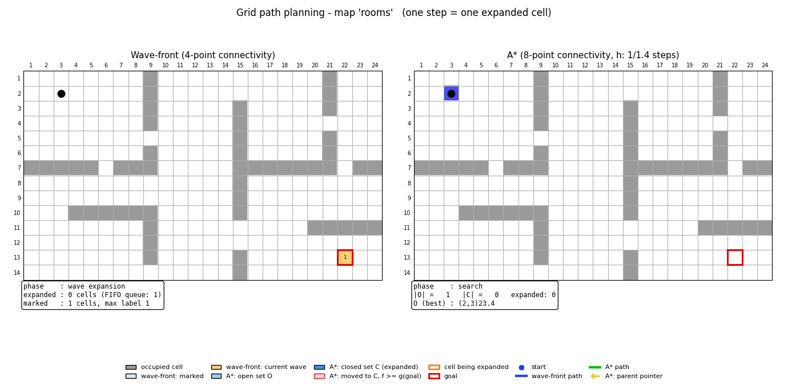

# Grid-Based Algorithms

The idea behind these algorithms is to map the environment. A map is a data structure that represents the environment where the robot moves. Mapping is the incremental process that builds a map using the information gathered from sensors. These algorithms are based on **occupancy grids** mapping:
- Grids are made by adjacent cells
- For each cell a flag indicates if an obstacles occupies the cell or not.
- The cell shape and size is chosen to match the environment and depends on the problem to solve.
  
The **resolution** (i.e. size of the cells) affects the success of the trajectory planning: an higher resolution increases the chance to find a path but it requires more memory space and more computing time.

Consider the case of square cells, the adjacency of two cells can be of two types:
- **4 point connectivity**, from the current cell the robot can only moves following the horizontal and vertical direction directions
- **8 point connectivity**, the robot can also moves following the diagonal directions

### Usage
```
    python grid_planners.py --all-gifs               # generate the 3 requested GIFs
    python grid_planners.py --map wf_slide --save grid_wf_slide.gif
    python grid_planners.py --map astar_slide --save grid_astar_slide.gif
    python grid_planners.py --map rooms --fps 8 --save grid_rooms.gif
```

## Wavefront Algorithm
1. mark the cell containing the goal point with _i = 1_
2. mark with _i + 1_ every adjacent cell to the one marked with _1_
3. repeat _step 2_ until the cell containing the start point is marked or all the cell of the environment have been marked
4. use gradient descent to go from the starting cell to the goal cell (the path is not unique!)

The implementation of the wavefront algorithm requires the construction of a tree such that each node contains the coordinates and the distance information. The root corresponds to the destination node. The assignment of labels to the cells typically follows the breadth-first visit logic

Wavefront algorithm characteristics:
- **complete**: if a path exists (at a given resolution), it is found
- **low efficiency**: the breadth-first search is inefficient, a large amount of non necessary cells can be visited to assign the distance numbers
- **optimal**: it finds the shortest path



## A* Algorithm
The A* algorithm has been developed to find a path in a graph. I takes into account the distance between the current location, the starting point and the goal point. To understand howw the algorithm works, we must introduce some notation:
 - **c(., .)** is the cost of the edge connecting two nodes (weighted graph), in our domain the cost could be the traveling distance.
 - **Neigh(V)** is the set of nodes adjacent to the node V
 - **O** is the open set (nodes under examination)
 - **C** is the closed set (set of visited nodes)
Then we consider the following functions:
 - **g(V)** is the cost of the backward path from V to the starting point
 - **h(V)** is the heuristic function that estimates the cost from V to the goal point
 - **f(V) = g(V) + h(V)** is an estimate of the total cost of the path from the starting point to the goal point passing through the node V.
 Each node contains the value of the heuristic, while edges are labeled with the cost.
 
 Application:
 1. at each step the node in the open set having the lower total cost is expanded
 2. once the goal is found, all the nodes in the open set having a total cost higher than the current path are removed
 3. the remaining nodes are examined since they may bring to a lower total cost path.



## Rooms Test

